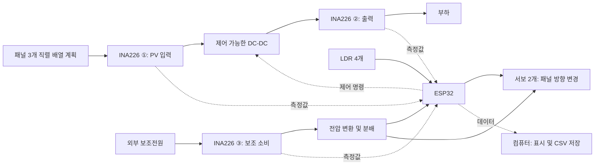

# 프로젝트 구상안

- 기준일: 2026-10-26
- 문서 상태: 구상 및 계획. 실제 장치의 구현·성능을 검증한 문서가 아님
- 완료 기한: 2026년 12월 첫째 주. 내부 완료 목표 12월 4일(금), 12월 5–6일 예비
- 관련 문서: [개발 계획](../development-plan.md), [실험 및 검증 계획](../experiments/validation-plan.md)

## 1. 연구 주제와 목적

**부분음영 환경에서 발전 효율 향상을 위한 이중축 태양 추적 및 Hybrid MPPT 기반 태양광 발전 시스템**을 제작하고 평가한다.

패널 방향을 바꾸는 태양 추적과 전기적 동작점을 바꾸는 MPPT를 결합한다. 두 기술의 기여를 각각 비교한 뒤, 탐색 손실과 보조 소비를 포함한 실제 취득 에너지를 평가한다. 제목의 '효율 향상'은 검증할 가설이며, 모든 조건에서 향상을 보장한다는 의미가 아니다.

| 연구 질문 | 비교 방법 | 판단할 결과 |
| --- | --- | --- |
| H1. 태양 추적이 고정형보다 순에너지를 높이는가? | 같은 P&O에서 고정형과 추적형 비교 | 발전·출력 에너지와 추적 소비를 반영한 순에너지 |
| H2. Hybrid가 부분음영에서 P&O보다 유리한가? | 방향과 음영 조건을 맞추고 P&O와 Hybrid 비교 | 누적 에너지, 기준 최대점 도달, 재추적 시간 |
| 통합 시스템은 어떤 조건에서 유리한가? | 고정형 P&O와 추적형 Hybrid 및 중간 조건 비교 | 전체 이득과 추적·MPPT별 기여 |

## 2. 개발 범위

### 1차 구현

- ESP32를 중심으로 LDR 4개와 서보 2개를 이용한 이중축 추적.
- INA226 3개를 활용한 PV 입력, 컨버터 출력, 보조 소비 측정.
- 제어 가능한 DC-DC 컨버터를 통한 패널 동작점 변경.
- P&O 기준 알고리즘, PSO 단독 시험, PSO → P&O Hybrid.
- 컴퓨터에서 측정값을 확인하고 CSV로 보관하는 기능.
- 무음영·부분음영 및 고정·추적 조건의 반복 비교와 결과 분석.

### 1차 범위에 포함하지 않는 확장

INC, 강화학습, 천문 계산 기반 추적, 클라우드 운영은 후속 확장으로 남긴다. 배터리 충전과 완전 자립 전원도 현재 목표로 확정하지 않았다. 우선 부하를 사용하는 실험 장치를 구성한다.

## 3. 현재 준비 상태

아래 내용은 제공된 부품목록과 대화에서 확인한 상태이다. 구매 사실과 입고·정상 동작 검증은 구분한다.

| 항목 | 확인된 내용 | 다음 확인 |
| --- | --- | --- |
| 태양광 패널 | 3 W × 3개 구매 | 실제 모델, 전압·전류, 크기·무게, 패널별 편차 |
| INA226 | 3개 구매 | 션트 저항, 주소 변경 방법, 모듈 정격, 측정 오차 |
| 서보 | 2개 구매 | 모델, 공급전압, 부하 전류, 사용 가능한 토크와 각도 |
| ESP32 | 구매 목록에 포함 | 실제 보드·칩과 핀 구성 |
| LDR 5528와 저항 | 구매 목록에 포함 | 수량, 저항값, 센서 편차; LDR 4개 사용 계획 |
| 바이패스 다이오드 | 구매 목록에 포함 | 형명, 수량, 정격, 연결 방향과 적용 위치 |
| 컨버터·서보 전원 | 구매 전으로 확인 | 사양 확인 후 선정 |
| 부하·프레임·계측 장비 | 미확정 | 보유·대여·구매 여부와 사용 조건 |

패널의 3 W 표기만으로 운전 전압이나 직렬 배열의 최대전압을 확정하지 않는다. 세 패널의 정격전력 합계는 9 W지만 실제 발전량은 환경과 동작점에 따라 달라진다.

## 4. 하드웨어와 소프트웨어 구성

다음은 기능과 측정 위치를 설명하는 개념도다. 실제 단자 배선도나 제작 승인 회로도가 아니다.



### 전력·기구 설계

- 세 패널을 하나의 직렬 배열로 사용하는 구성을 우선 검토하고 패널별 바이패스 경로를 확인한다.
- 컨버터는 패널 운전 범위와 부하에 맞춰 승압·강압 등 방식을 선정한다. 일반 가변저항식 모듈의 외부 제어 가능 여부를 가정하지 않는다.
- 입력 최대전압, 부하 수용 범위, 전류, 발열을 확인한 뒤 제어 한계를 정한다.
- 서보는 적합한 외부 전원에서 공급하고 프레임은 무게중심·하중·배선 간섭을 고려한다.
- 입력 측정과 출력 측정은 각각 센서가 실제로 측정하는 단자 경계를 명시한다. 션트·배선 손실의 포함 여부도 기록한다.
- 보조 소비 경로에는 실제 포함한 장치와 전압 변환 손실을 명시한다. USB 등 별도 전원은 누락하지 않는다.

### 소프트웨어 역할

| 위치 | 실행할 기능 | 저장소 위치 |
| --- | --- | --- |
| ESP32 | 센서 측정, 추적 판단, MPPT, 컨버터 명령, 상태 관리, 데이터 전송 | `firmware/src/` |
| 대시보드 | 측정값·상태 표시와 기록 조작 화면 | `software/dashboard/` |
| PC 수집 도구 | 수신 데이터의 파일 저장; 선택한 통신 방식에 따라 사용 | `software/logger/` |
| 분석 환경 | CSV에서 에너지·재추적·전력 변동 계산과 그래프 생성 | `analysis/` |
| 시뮬레이션 | PV·컨버터 모델과 부분음영 알고리즘 비교 | `simulation/` |

Arduino IDE는 ESP32 프로그램 작성·업로드 도구다. 실험 대시보드와 데이터 저장 프로그램의 역할은 별개다. PC 수집·분석 프로그램은 PC에서 실행한다.

## 5. 제어 구상

### 태양 추적

LDR의 좌우·상하 밝기를 비교해 각 축을 조금씩 움직인다. 센서 편차 확인, 평균 처리, 불감대, 명령 각도 제한부터 적용하고 필요할 때 제어를 개선한다. 위치 센서가 없는 경우 기록하는 각도는 실제 측정 각도가 아니라 서보 명령 각도다.

### P&O와 PSO

현재 구상은 듀티 후보를 시험해 전력을 비교하는 방식이다. 컨버터의 외부 인터페이스가 전압·전류 기준값을 요구하면 제어 계층을 두거나 탐색 변수를 조정하고, 모든 비교 알고리즘에 같은 인터페이스와 운전 범위를 적용한다.

후보 적용 후에는 컨버터 안정화와 새 센서 측정을 기다린 뒤 평균 전력을 평가한다. PWM 발생 주기, 센서 갱신 주기, MPPT 판단 주기, 데이터 기록 주기는 구분한다. 제한된 PSO 탐색으로 실제 전역 최적점을 항상 찾는다고 가정하지 않는다.

### Hybrid 전환

```text
초기화·측정 확인
    → PSO 탐색
    → 탐색한 최적 후보 재적용
    → 운전점 안정화
    → P&O 이전 측정값과 상태 초기화
    → P&O 추적
    → 조건 변화 또는 정기 재탐색 시 PSO로 복귀
```

- PSO 동안에는 패널 각도 변경을 중지한다. 자세 유지에 필요한 서보 소비는 계속 측정한다.
- 재탐색은 기동, 지속적인 전력 변화, 정기 탐색을 후보 조건으로 두고 시험으로 조정한다.
- 전력 변화만으로 부분음영이 확정되었다고 판단하지 않는다.
- 범위 제한과 센서 이상 처리는 모든 알고리즘에 동일하게 적용한다. 스위칭 정지와 물리적 출력 차단은 회로별로 구분한다.

## 6. 데이터 수집 구상

첫 목표는 패널 한 개의 전압·전류·전력을 CSV로 저장하는 것이다. USB 수집과 SolarDuel의 Wi-Fi 웹 대시보드를 검토한 뒤 한 방식을 우선 완성한다. 두 방식을 동시에 개발할 필요는 없다.

측정과 기록은 브라우저 요청이나 화면 갱신과 분리한다. ESP32의 임시 메모리와 PC에 저장된 파일을 구분하고, 선택한 저장 경로가 중단됐을 때의 누락을 기록한다. 수집 주기와 저장 항목은 [실험 계획](../experiments/validation-plan.md#4-데이터-기록)에 따른다.

## 7. 참고 자료의 활용 범위

| 자료 | 참고할 부분 | 적용 시 확인 |
| --- | --- | --- |
| [SolarDuel](https://github.com/waldd00/SolarDuel) | 추적, INA226, 웹 화면, CSV | 원본 추적은 STM32용; ESP32 중심 구성과 센서 3개로 변경 필요 |
| [SolarDuel Logger](https://github.com/waldd00/SolarDuel/blob/main/Software_ESP32_Logger/SolarDuel_ESP32_Logger.ino) | 화면과 기록 기능 | 브라우저 요청 기반 기록과 임시 버퍼를 실험용으로 보완 |
| [LibreSolar](https://github.com/LibreSolar/charge-controller-firmware) | 측정·보호·전력제어 모듈 구성 | 전력 규모·회로·실행 환경이 달라 직접 이식 범위 검토 |
| [PV MPPT Simulink](https://github.com/iamsujitt/pv-mppt-simulink) | PV·Boost·P&O 구조 | 소형 장치 파라미터, 부분음영 구성, MATLAB 의존성 확인 |
| [기존 PSO 자료](https://github.com/AbhishekDGoudar/Particle-Swarm-Optimization-Based-Maximum-Power-Point-Tracker-Algorithm/blob/master/PSO%20Algorithm.m) | 탐색 개념과 비교 | 공개 스크립트는 단계적 듀티 탐색이며 PSO 구현으로 그대로 채택하지 않음 |
| [부분음영 RL 모델](https://github.com/SmartSystems-UniAndes/PV_MPPT_Control_Based_on_Reinforcement_Learning) | 구간별 일사량·바이패스 시험 환경 | DQN은 1차 범위 밖; 모델과 라이브러리 호환성 확인 |

실제 외부 자료를 도입하면 저장소 URL, 커밋, 파일, 수정 내용, 라이선스를 기록한다. 코드를 복사하기 전에 개별 자료의 조건을 확인하며, 기구물의 별도 조건도 구분한다.

## 8. 미결정 사항

| ID | 결정할 내용 | 결정 근거 |
| --- | --- | --- |
| D01 | 컨버터 방식·제품·제어 입력 | 패널 사양과 부하 운전 범위 |
| D02 | 부하와 출력 운전 범위 | 발전 전력을 수용하고 동작점을 탐색할 수 있는지 |
| D03 | 서보 전원과 프레임 | 실제 모델·하중·시험 전류 |
| D04 | INA226 배치·션트·주소·배선 | 모듈 사양과 교정 결과 |
| D05 | USB 또는 Wi-Fi 우선 수집 방식 | 단독 시험의 안정성과 구현 부담 |
| D06 | 핀·PWM·평가 간격·허용 듀티 | 보드·컨버터 선정과 응답 측정 |
| D07 | 추적·탐색·재탐색 파라미터 | 반복 시험과 에너지 손실 평가 |
| D08 | 정확한 제출 시각·담당자 | 12월 첫째 주 완료 기한 안에서 팀과 지도교수 확인; 내부 목표 12월 4일 |

수치가 미정인 항목을 임의 확정하지 않고, 선정·시험 결과와 함께 갱신한다.
