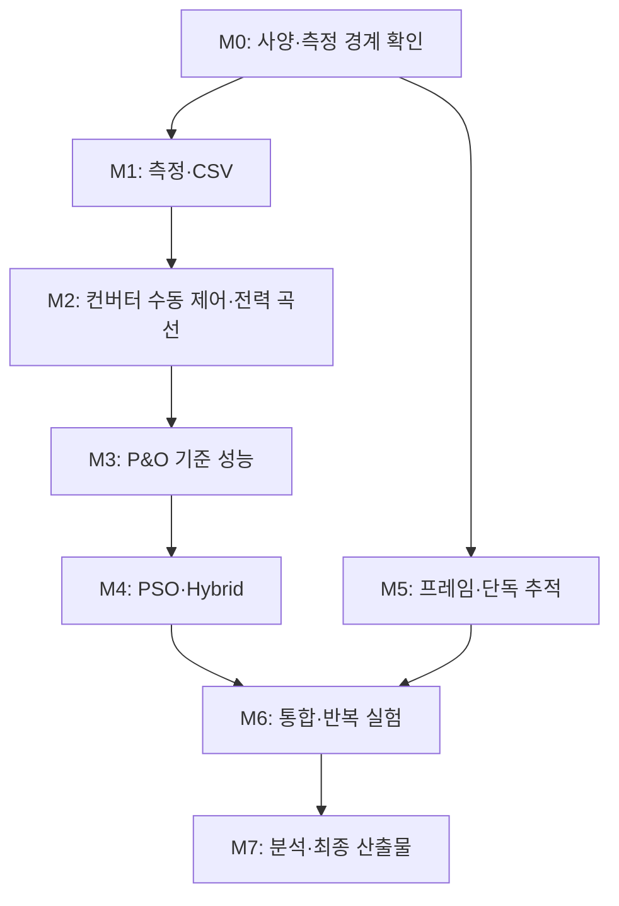

# 개발 계획

- 기준일: 2026-10-26
- 현재 상태: 일부 부품 구매, 문서·폴더 구성; 조립과 프로그램 동작은 미검증
- 계획 시작: 2026-10-26
- 완료 기한: 사용자 지정 2026년 12월 첫째 주
- 내부 완료 목표: 2026-12-04(금). 12월 5–6일은 예비일이며 정확한 제출 시각·담당자는 확인 필요
- 관련 문서: [구상안](design/project-concept.md), [실험 및 검증 계획](experiments/validation-plan.md)

## 1. 진행 방식

측정·기록을 공통 기반으로 만들고, 전력제어와 추적을 단독 검증한 후 통합한다. 각 단계는 코드 작성 여부가 아니라 결과물과 완료 기준으로 판단한다. 성공한 연결·설정과 해당 코드 커밋을 함께 기록한다.

## 2. 단계별 작업과 완료 기준

| 단계 | 할 일 | 산출물 | 완료 기준 |
| --- | --- | --- | --- |
| M0 사양 정리 | 입고 부품 식별, 패널·서보·센서 사양 확인, 부하·전원·컨버터 선정, 계측기 확보 | 부품 사양표, 전력·측정 경계도, 구매·대여 목록 | 구성 요소의 정격과 제어 방법을 설명하고 미정 항목의 담당·확인 방법을 정함 |
| M1 측정·기록 | ESP32 환경 준비, LDR·INA226 개별 시험, 센서 비교·교정, PC CSV 저장 | 배선 기록, 오차 확인표, 첫 CSV | 패널 한 개의 측정값과 실제 시각을 연속 저장하고 기준 계측기 차이·누락을 확인함 |
| M2 전력부 | 컨버터·부하 단독 시험, 수동 제어, 안정화 시간 측정, 무음영·부분음영 스윕 | 제어 범위표, 응답 그래프, P–V 곡선 | 명령에 따른 동작점 이동과 유효 운전 범위를 확인하고 부분음영 곡선의 재현성을 평가함 |
| M3 P&O | 같은 측정·제어 경로로 P&O 구현, 시작점·변화량·평가 간격 시험 | P&O 코드, 설정표, 기준 시험 데이터 | 무음영에서 기준 최대점 부근을 추적하고 부분음영의 성공·실패 조건을 기록함 |
| M4 PSO·Hybrid | PSO 후보 적용·평가, 최적 후보 복귀, P&O 상태 초기화, 재탐색 | PSO·Hybrid 코드, 전환 로그, 반복 결과 | 후보별 새 측정값 사용, 공통 범위 제한, 전환·재탐색을 로그로 검증함 |
| M5 추적 | 서보 단독, 축별 프레임, 패널 1개 후 전체 배열 시험, LDR 편차·불감대 조정 | 기구·배선 자료, 각도 범위, 추적·소비 기록 | 두 축 방향과 한계를 확인하고 실제 하중에서 자세 유지와 불필요한 이동을 평가함 |
| M6 통합·실험 | 추적과 Hybrid 연동, 기록 안정성 점검, 비교 조건 반복 | 조건표, 실험 기록, 원본 CSV, 오류·실패 기록 | 계획한 비교가 완료되고 누락·환경 변화·실패 사례가 구분됨 |
| M7 분석·정리 | 에너지·재추적·정상상태 분석, 한계 정리, 재현 절차 작성 | 분석 코드·그래프·가공 데이터, 최종 보고서·발표 자료 | 원본에서 결과를 재계산할 수 있고 실제 하드웨어와 시뮬레이션의 증거 범위를 구분함 |

완료 기준의 정량 오차·시간·허용 변동은 초기 측정 후 실험 계획에 고정한다. 아직 시험하지 않은 기준을 달성했다고 표시하지 않는다.

## 3. 12월 첫째 주까지의 6주 일정

10월 26일부터 12월 첫째 주(11월 30일–12월 6일)까지 약 6주로 계획한다. 12월 4일까지 장치·실험·분석·보고서를 내부 완료하고, 5–6일을 오류 수정과 제출 준비의 예비일로 남긴다. 이는 팀의 내부 계획이며 정확한 제출일을 임의로 확정한 것은 아니다.

| 주차·기간 | 주 작업 | 함께 진행할 작업 | 주말까지 확인할 결과 |
| --- | --- | --- | --- |
| 1주: 10/26–11/01 | M0, M1: 부품 사양·측정 경계·첫 CSV | 컨버터·전원·부하 확보, 프레임 구상과 개발 환경 준비 | 센서 단독 동작과 원본 기록; 전력부 확보 경로 |
| 2주: 11/02–11/08 | M2: 컨버터 수동 제어·무음영 및 부분음영 스윕 | 서보·기구·LDR 단독 시험, 시뮬레이션 사용 가능 여부 확인 | 제어 범위·안정화 시간·기준 곡선과 다중 피크 발생 여부 |
| 3주: 11/09–11/15 | M3: P&O 기준 성능 | PSO 단독 개발, M5 추적 장치 시험, 분석 틀 작성 | P&O 기준 데이터; 추적 단독 결과; PSO 후보 평가 동작 |
| 4주: 11/16–11/22 | M4: PSO·Hybrid 검증, M5 및 통합 동작 확인 | 재탐색·기록 안정성 확인, 예비 비교 실험 | Hybrid 전환과 실제 하중 추적; 본 실험용 코드·설정·구성 확정 |
| 5주: 11/23–11/29 | M6: A–D와 확정 음영 조건의 반복 비교 | 측정 직후 분석, 실패 원인 확인과 필요한 재시험 | 본 실험 원본·조건표·반복 지표와 한계 정리 |
| 6주: 11/30–12/04 | M7: 최종 분석·보고서·발표·시연 정리 | 꼭 필요한 결측 시험 보완, 재현 절차와 최종 저장소 점검 | 장치 시연, 재계산 가능한 결과, 보고서·발표 자료 내부 완료 |
| 예비: 12/05–12/06 | 오류 수정·제출 준비 | 새 기능보다 결과·자료 점검 우선 | 확인된 제출 시각 안에 최종 제출 |

### 일정 운영과 판단 시점

- **10/30:** 컨버터·전원·부하의 선정과 도착 또는 대여 경로를 확인한다. 납기가 맞지 않으면 교내 장비나 확보 가능한 구성으로 시험 경로를 검토한다.
- **11/08:** 전력부 제어와 부분음영 곡선의 실현 가능성을 점검한다. 문제가 있으면 장치 개선과 시뮬레이션 경로를 병행 준비한다.
- **11/15:** 실물 MPPT 검증이 계속 어려우면 하드웨어 추적·시뮬레이션 Hybrid로 증거 범위를 나누는 대안을 검토해 11/22까지 최종 실험 경로를 확정한다.
- **11/22:** 본 실험의 기능·코드·파라미터를 고정한다. 이후 필요한 수정은 이유와 버전을 기록하고 영향받는 비교 조건을 재시험한다. 새 확장 기능은 추가하지 않는다.
- **11/29:** 주요 비교 데이터를 확보한다. 마지막 주에 분석을 시작하지 않도록 수집과 분석을 함께 수행한다.
- **12/04:** 장치, 분석 결과, 보고서, 발표·시연 준비를 내부 완료한다.

약 6주 안에 완료하려면 측정·전력제어, 추적·기구, 기록·분석 작업을 분담해 함께 진행한다. 보고서에는 매주 검증된 구성·결과를 누적한다. 주차가 도래했다는 이유로 검증되지 않은 전력부 위에 알고리즘을 통합하지 않으며, 미완성 기능은 실제 성능으로 보고하지 않는다.

## 4. 팀 역할 초안

인원과 이름은 미정이다. 한 사람이 여러 역할을 맡거나 작업을 나눌 수 있다.

| 역할 | 책임 | 다른 역할에 전달할 내용 |
| --- | --- | --- |
| 전력·계측 | 패널, 센서 교정, 컨버터, 부하, 전원 | 측정 단위·부호·유효 범위·안정화 시간 |
| 추적·기구 | 프레임, 서보, LDR, 이동 제한 | 명령 각도·이동 상태·자세 유지·소비 |
| MPPT·통합 | P&O, PSO, Hybrid, 상태·오류 관리 | 탐색 변수·운전 모드·전환·재탐색 이벤트 |
| 기록·분석 | 수집 경로, CSV, 시험 조건, 지표·그래프 | 파일 형식·시험 ID·분석 가능 여부 |

통합 전에는 단위, 측정 시각, 제어 변수, 오류 표시, 모터 이동 신호를 먼저 맞춘다. 스위칭 신호 발생과 상위 MPPT 판단의 실행 주기는 구분한다.

## 5. 바로 수행할 작업

- [ ] 패널·ESP32·서보·INA226·다이오드의 실제 모델과 사양을 정리한다.
- [ ] 교내 계측 장비·전원·전자부하의 사용 가능 여부를 확인한다.
- [ ] 전력 공급 경로와 INA226 3개의 측정 경계를 그린다.
- [ ] 패널 특성과 부하에 맞는 컨버터·서보 전원을 선정한다.
- [ ] Arduino IDE와 ESP32 환경을 준비하고 단독 프로그램 업로드를 확인한다.
- [ ] INA226 한 개부터 기준 계측기와 비교하고 첫 CSV를 저장한다.
- [ ] 12월 첫째 주의 정확한 제출 시각과 팀 역할을 확인하고 6주 일정의 담당자를 정한다.

이 목록은 수행 예정이며 완료 표시가 아니다. 실제 작업 후 증거와 함께 갱신한다.

## 6. 문제 발생 시 대응

| 문제 | 먼저 확인할 것 | 계획 조정 |
| --- | --- | --- |
| 컨버터 외부 제어 불가 또는 범위 부적합 | 데이터시트·부하·실측 운전 범위 | 알고리즘 개발 전에 제어 계층 또는 부품 변경 |
| 부분음영에서 다중 피크가 확인되지 않음 | 직렬 구성·바이패스·차광·스윕 범위 | M2에서 재검토; 어렵다면 하드웨어 추적과 시뮬레이션 Hybrid로 범위 분리 |
| 센서 오차·노이즈가 전력 차이보다 큼 | 션트·교정·전원·갱신 시간 | 측정 경로와 평가 간격 개선 후 비교 |
| 서보 힘 부족·흔들림·소비 과다 | 하중·무게중심·전원·불감대 | 프레임·이동 주기 조정, 패널 1개부터 재검증 |
| 통신 누락·화면 의존 기록 | 측정 스케줄·버퍼·전송·파일 저장 | 수집 방식 하나를 안정화하고 누락 표시 |
| Hybrid의 탐색 손실이 큼 | 후보 수·대기·반복·재탐색 빈도 | 조건을 고정해 조정하고 개선되지 않은 결과도 보고 |

실물과 시뮬레이션을 분리한 경우 이를 완전 통합 하드웨어 성능으로 보고하지 않는다.

## 7. 작업·변경 기록 원칙

- 설계·부품·파라미터 변경은 이유와 적용 날짜, 코드 커밋을 남긴다.
- 원본 데이터는 `data/raw/`, 가공 데이터는 `data/processed/`, 분석 코드는 `analysis/`에 둔다.
- 부품 사양·배선은 `docs/design/`와 `hardware/`, 실험 조건은 `docs/experiments/`에서 관리한다.
- 시험 ID로 설정·원본 파일·그래프·결론을 연결한다.
- 실제 도입한 외부 자료의 출처·버전·라이선스를 기록한다.
- 기능 구현 후 빌드·실행 방법을 추가한다. 현재 문서 작성만으로 실행 가능한 시스템이 준비된 것은 아니다.
